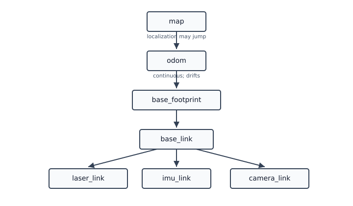

# Chapter 02 — Linear algebra refresh for robotics

> **License:** [CC BY-NC 4.0](https://creativecommons.org/licenses/by-nc/4.0/).  
> **Hardware:** none.  
> **Lab code:** course container ([`docker/compose.yaml`](../docker/compose.yaml)); NumPy exercises run inside the Humble image or on the host.

## Learning goals

1. Refresh vectors, matrices, norms, and solving \(Ax = b\) in robotics language.
2. Represent planar and spatial orientations with rotation matrices; use homogeneous transforms for frames on a mobile robot.
3. Compose and invert rigid transforms; convert yaw \(\leftrightarrow\) \(SO(2)\) for a differential-drive base.
4. Connect this notation to the kinematics and estimation chapters that follow.

## 2.1 Why robotics keeps asking for linear algebra

Almost every later algorithm is a story about **vectors in frames** and **linear (or locally linear) maps**:

- Wheel speeds \(\mapsto\) body twist \(\mapsto\) world velocity.
- A Kalman filter update is a linear combination of a prediction and a measurement residual.
- Costmaps and Jacobians are matrices; covariances are symmetric positive-definite matrices.

You do not need a second semester of abstract algebra. You need fluency with dimensions, bases, and composition—especially in **2D**, because the Limo Pro lives primarily in the plane.

**Notation.** Column vectors by default. World frame \(W\), robot base \(B\) (often `base_link` in ROS). A point expressed in frame \(A\) is \({}^{A}p\). Rotation \({}^{A}_{B}R\) maps coordinates from \(B\) into \(A\): \({}^{A}p = {}^{A}_{B}R\,{}^{B}p\).

## 2.2 Vectors, inner products, and norms

For \(u, v \in \mathbb{R}^{n}\),

\[
u^{\top} v = \sum_{i=1}^{n} u_{i} v_{i}, \qquad
\|u\|_{2} = \sqrt{u^{\top} u}.
\]

Geometric intuition: \(u^{\top} v = \|u\|\|v\|\cos\theta\). Orthogonality (\(u^{\top} v = 0\)) appears constantly—wheel axes, principal axes of uncertainty ellipses, and columns of rotation matrices.

Weighted norms matter for estimation. If \(P\) is a covariance, the Mahalanobis distance \(\sqrt{r^{\top} P^{-1} r}\) measures how surprising a residual \(r\) is. We return to this in Chapter 06.

## 2.3 Matrices as linear maps

A matrix \(A \in \mathbb{R}^{m \times n}\) defines \(x \mapsto Ax\). In robotics:

| Situation | Typical shape | Meaning |
|-----------|---------------|---------|
| Stacked scalar measurements | tall \(A\) | Overdetermined sensing |
| Underactuated mapping | wide or rank-deficient \(A\) | Not every twist is achievable |
| Jacobian \(J\) of \(h(x)\) | \(m \times n\) | Local observation model |

Rank and nullspace answer physical questions: *What motions produce zero wheel slip residual? Which landmark configurations make triangulation singular?*

Solving \(Ax = b\):

- Square and invertible: \(x = A^{-1}b\) (rarely form the inverse explicitly—use a solver).
- Overdetermined: least squares \(x = \arg\min \|Ax - b\|_{2}\), normal equations \(A^{\top} A x = A^{\top} b\) when \(A\) has full column rank.
- In NumPy: `numpy.linalg.solve` / `lstsq`. Prefer these over hand-rolled inverses.

## 2.4 Rotations in 2D: \(SO(2)\)

A planar heading \(\theta\) (yaw) corresponds to

\[
R(\theta) =
\begin{bmatrix}
\cos\theta & -\sin\theta \\
\sin\theta & \cos\theta
\end{bmatrix}
\in SO(2).
\]

Properties you will use weekly:

1. \(R^{\top} R = I\) and \(\det R = 1\) (pure rotation, no reflection).
2. \(R(\theta)^{-1} = R(-\theta) = R^{\top}\).
3. Composition: \(R(\theta_{1}) R(\theta_{2}) = R(\theta_{1}+\theta_{2})\).

Body velocity \((v_{x}, v_{y})\) in the base frame becomes world velocity \(R(\theta)\,(v_{x}, v_{y})\) when the robot’s yaw is \(\theta\). That single line is the heart of unicycle kinematics (Chapter 03).

**ROS convention reminder.** In `geometry_msgs/Twist`, `linear.x` is forward in `base_link` for a typical differential-drive URDF. Confirm your adapted Limo frames in [`docs/adaptation-notes/limo.md`](../docs/adaptation-notes/limo.md) before trusting signs.

## 2.5 A taste of 3D: \(SO(3)\) without heavy Lie theory

For IMU and camera extrinsics you need 3D rotations. Elementary building blocks are rotations about principal axes, e.g.

\[
R_{z}(\psi) =
\begin{bmatrix}
\cos\psi & -\sin\psi & 0 \\
\sin\psi & \cos\psi & 0 \\
0 & 0 & 1
\end{bmatrix}.
\]

Roll–pitch–yaw compositions are common in robotics middleware but suffer singularities (gimbal lock). Internally, many estimators use quaternions; ROS 2 `geometry_msgs/Pose` stores orientation as a quaternion. For this course’s *planar* mobile-base chapters, treat 3D as “extrinsics and IMU exist; we project to 2D when the map is planar.” Deeper \(SO(3)\) / Lie-group estimation can be assigned as graduate reading (e.g. Barfoot, *State Estimation for Robotics*).

## 2.6 Homogeneous transforms

Combine rotation and translation \(t \in \mathbb{R}^{2}\) (or \(\mathbb{R}^{3}\)) into one matrix:

\[
{}^{A}_{B}T =
\begin{bmatrix}
{}^{A}_{B}R & {}^{A}t_{B} \\
0^{\top} & 1
\end{bmatrix},
\qquad
\begin{bmatrix} {}^{A}p \\ 1 \end{bmatrix}
=
{}^{A}_{B}T
\begin{bmatrix} {}^{B}p \\ 1 \end{bmatrix}.
\]

Composition along a kinematic chain:

\[
{}^{W}_{S}T = {}^{W}_{B}T\,{}^{B}_{S}T
\]

takes a point from sensor frame \(S\) into the world. Inversion:

\[
{}^{B}_{A}T = ({}^{A}_{B}T)^{-1}
=
\begin{bmatrix}
R^{\top} & -R^{\top} t \\
0^{\top} & 1
\end{bmatrix}.
\]

**Frames on the course Limo-class robot** match [`physibot_limo.urdf.xacro`](../code/ros2_ws/src/physibot_description/urdf/physibot_limo.urdf.xacro) / [`limo_body.xacro`](../code/ros2_ws/src/physibot_description/urdf/limo_body.xacro) (REP-105):

```text
map → odom → base_footprint → base_link → {laser_link, imu_link, camera_link}
```



- `map` → `odom`: corrected by localization (Ch. 07); may jump.
- `odom` → `base_footprint` / `base_link`: continuous odometry; drifts.
- `base_link` → sensors: fixed extrinsics (calibrate in Ch. 11–12).

`physibot_stub.urdf.xacro` remains only for ultra-thin smoke tests; labs use the Limo-class description above.

## 2.7 Poses as elements of \(SE(2)\)

A planar robot pose \(x = (x, y, \theta)\) is an element of \(SE(2)\). Composition of poses matches multiplication of homogeneous transforms. When filters add Gaussian noise in \((x,y,\theta)\) coordinates, remember that \(\theta\) is modular and that a Euclidean covariance is only a *local* chart—good enough for many EKFs, imperfect near large angular uncertainty (particle filters help; Ch. 07).

## 2.8 Lab 02 — Transforms in NumPy

Enter the course container (Chapter 01). You may use system Python with NumPy if installed in the image, or run on the host for this math-only lab.

```python
import numpy as np

def R2(theta: float) -> np.ndarray:
    c, s = np.cos(theta), np.sin(theta)
    return np.array([[c, -s], [s, c]])

def T2(theta: float, t: np.ndarray) -> np.ndarray:
    T = np.eye(3)
    T[:2, :2] = R2(theta)
    T[:2, 2] = t
    return T

def inv_T2(T: np.ndarray) -> np.ndarray:
    R = T[:2, :2]
    t = T[:2, 2]
    Ti = np.eye(3)
    Ti[:2, :2] = R.T
    Ti[:2, 2] = -R.T @ t
    return Ti

# Compose: world ← base ← sensor
T_WB = T2(np.deg2rad(30), np.array([1.0, 0.5]))
T_BS = T2(0.0, np.array([0.2, 0.0]))  # laser 20 cm forward
T_WS = T_WB @ T_BS
assert np.allclose(inv_T2(T_WS) @ T_WS, np.eye(3), atol=1e-9)
print("T_WS =\n", T_WS)
```

### Exercises in the lab

1. Compose two planar transforms and verify \(T^{-1}T = I\) numerically.
2. Convert yaw \(45^{\circ}\) to \(R(\theta)\) and rotate the body-forward vector \((1,0)\) into the world.
3. Given \({}^{W}_{B}T\) and a point in the laser frame, compute world coordinates.
4. *(Grad)* Show that left-multiplying by a world-fixed transform and right-multiplying by a body-fixed transform move the robot differently; sketch both.

## 2.9 Common pitfalls

- **Degrees vs. radians** — NumPy and ROS use radians; humans use degrees in conversation.
- **Active vs. passive rotations** — be consistent; ROS transform libraries document the convention they apply.
- **Row-major confusion** — write shapes down; `(2,)` vs `(2,1)` bites everyone once.
- **TF timing** — algebraic \(T\) assumes a single instant; ROS TF needs timestamps (Ch. 05).

## 2.10 Further reading

- Barfoot, *State Estimation for Robotics* — frames and \(SE(3)\) done carefully.
- Solà et al., “A micro Lie theory for state estimation in robotics” (arXiv) — optional grad depth.
- [REP 105: Coordinate Frames for Mobile Platforms](https://www.ros.org/reps/rep-0105.html)
- [tf2 documentation (Humble)](https://docs.ros.org/en/humble/Tutorials/Intermediate/Tf2/Tf2-Main.html)

## Pedagogical defaults (resolved)

- Frame names are locked to the course URDF (`base_footprint`, `base_link`, `laser_link`, `camera_link`, `imu_link`).
- Optional NumPy Jupyter notebook remains a nice-to-have, not a blocker.
