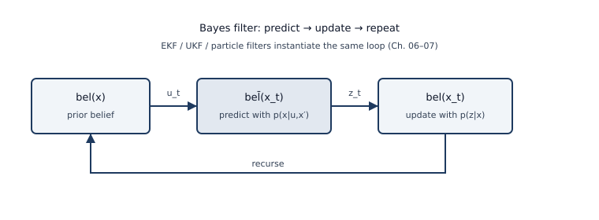

# Chapter 06 — Estimation fundamentals

> **License:** [CC BY-NC 4.0](https://creativecommons.org/licenses/by-nc/4.0/).  
> **Hardware:** simulation only.  
> **Lab code:** course container; later configs may use [`robot_localization`](https://docs.ros.org/en/humble/p/robot_localization/)-style patterns inside `physibot_bringup`.

## Learning goals

1. State the Bayes filter recursion in robotics language.
2. Derive and use a linear Kalman filter; extend to an EKF for unicycle pose.
3. Know when to reach for UKF or particle filters.
4. Diagnose inconsistency and covariance tuning problems on a simulated example.

## 6.1 Probabilistic state estimation

Let \(x_{k}\) be the state (e.g. pose and maybe biases) and \(z_{k}\) a measurement. The **Bayes filter** updates a belief \(\mathrm{bel}(x_{k}) = p(x_{k}\mid z_{1:k}, u_{1:k})\):

**Predict**

\[
\overline{\mathrm{bel}}(x_{k}) = \int p(x_{k}\mid x_{k-1}, u_{k})\,\mathrm{bel}(x_{k-1})\,dx_{k-1}
\]

**Update**

\[
\mathrm{bel}(x_{k}) = \eta\, p(z_{k}\mid x_{k})\,\overline{\mathrm{bel}}(x_{k})
\]

with normalizing constant \(\eta\). Physical models enter twice: the **motion model** \(p(x_{k}\mid x_{k-1}, u_{k})\) and the **observation model** \(p(z_{k}\mid x_{k})\) from Chapters 03–05.

## 6.2 Linear Gaussian case: the Kalman filter

If

\[
x_{k} = F x_{k-1} + B u_{k} + w_{k}, \qquad
z_{k} = H x_{k} + v_{k},
\]

with \(w_{k}\sim\mathcal{N}(0,Q)\), \(v_{k}\sim\mathcal{N}(0,R)\), and a Gaussian prior, the belief stays Gaussian \(\mathcal{N}(\hat x, P)\) and the Kalman filter is optimal among linear estimators.

**Predict:** \(\hat x^{-} = F\hat x + Bu\), \(P^{-} = FPF^{\top}+Q\).

**Update:** \(K = P^{-} H^{\top}(HP^{-}H^{\top}+R)^{-1}\), \(\hat x = \hat x^{-} + K(z - H\hat x^{-})\), \(P = (I-KH)P^{-}\).

**Pedagogy tip.** Tune \(Q\) and \(R\) as statements about trust, not mystical dials: large \(R\) means “don’t believe this sensor,” large \(Q\) means “my motion model is sloppy.”

## 6.3 EKF for unicycle + landmarks

Nonlinear \(f\) and \(h\) break the closed-form KF. The **extended Kalman filter** linearizes:

\[
F_{k} = \frac{\partial f}{\partial x}\Big|_{\hat x, u}, \qquad
H_{k} = \frac{\partial h}{\partial x}\Big|_{\hat x^{-}}.
\]

Example: state \(x=(x,y,\theta)\), control \((v,\omega)\), landmark range-bearing measurement from Chapter 05. The EKF prediction uses the discrete unicycle; the update uses \(H\) from the landmark Jacobian.

**Failure modes.** Strong nonlinearity, multimodal beliefs (kidnapped robot), and overconfident \(P\) (inconsistency). When the true error exceeds what \(P\) claims, fusion becomes brittle.

## 6.4 UKF and particle filters (pointers)

| Method | Idea | Use when |
|--------|------|----------|
| **UKF** | Deterministic sigma-point propagation | Smooth nonlinearities; avoid Jacobians |
| **Particle filter** | Weighted samples | Multimodal pose on maps (AMCL) |
| **Information filter** | Dual of KF | Some mapping/SLAM formulations |

Chapter 07 develops particle localization on occupancy maps in Nav2. Treat UKF as a drop-in EKF cousin for continuous tracking when Jacobians hurt.

## 6.5 Consistency checks

Practical diagnostics:

1. **Normalized innovation squared (NIS)** — residuals should match \(S = HPH^{\top}+R\) on average.
2. **NEES** on simulated ground truth — is \(P\) honest?
3. **Plot \(\pm 3\sigma\) gates** on \(x,y,\theta\) against truth in sim.

If NEES is always huge, you are overconfident (inflate \(Q\)/`R` thoughtfully, fix models). If always tiny, you may be underconfident or evaluating wrong.

## 6.6 From notebooks to ROS

Teaching filters in NumPy clarifies math. Deployment often uses packages such as [`robot_localization`](https://docs.ros.org/en/humble/p/robot_localization/) (EKF/UKF fusion of odom + IMU) alongside Nav2’s AMCL for global pose. PhysiBot’s stance: **learn the equations once**, then configure battle-tested nodes—don’t maintain a one-off filter in production without a reason.

## 6.7 Lab 06 — EKF on simulated odometry + landmarks

### Part A — NumPy EKF

Simulate a unicycle with noisy controls. Place 3–5 known landmarks; generate range-bearing measurements with \(R = \mathrm{diag}(\sigma_{r}^{2}, \sigma_{b}^{2})\). Implement EKF; plot true pose, estimate, and covariance ellipses.

### Part B — Ablations

1. Remove landmarks for 10 s (odometry only).
2. Double range noise.
3. Use wrong wheelbase in \(f\) (model mismatch).

Write three sentences on which ablation hurt most and why.

### Part C — ROS bag replay (optional)

Replay a bag from Chapter 05 and compare fused yaw from IMU+odom vs. odom alone once a fusion node is configured in `physibot_bringup`.

## 6.8 Exercises

1. Write predict/update equations for 1D constant-velocity KF tracking position.
2. Derive \(F\) for the unicycle Euler step with respect to \((x,y,\theta)\).
3. *(Grad)* Implement UKF on the same landmark problem; compare NEES to EKF.

## 6.9 Further reading

- Thrun, Burgard, Fox — *Probabilistic Robotics* (Bayes filter, EKF, PF).
- Barfoot — *State Estimation for Robotics*.
- [robot_localization docs](https://docs.ros.org/en/humble/p/robot_localization/)
- Julier & Uhlmann — UKF original papers (grad)

## Pedagogical defaults (resolved)

- Mid-course fusion: prefer AMCL + odom for Ch. 07–09; optional `robot_localization` YAML is a stretch, not required for the core ladder.
- Grader NumPy notebooks remain optional staff artifacts (not student blockers).
