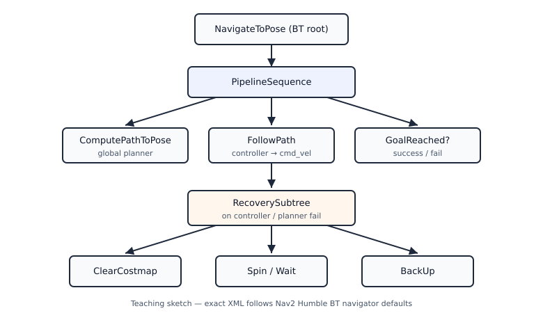

# Chapter 09 — Navigation with Nav2

> **License:** [CC BY-NC 4.0](https://creativecommons.org/licenses/by-nc/4.0/).  
> **Hardware:** simulation only (physical robot in Chapter 12).  
> **Lab code:** [`physibot_bringup/config/`](../code/ros2_ws/src/physibot_bringup/config/), [`docs/adaptation-notes/nav2.md`](../docs/adaptation-notes/nav2.md).

## Learning goals

1. Sketch Nav2’s architecture: planners, controllers, costmaps, behavior trees.
2. Configure a differential-drive footprint and velocity limits for a Limo-class robot.
3. Send navigation goals and interpret failures in RViz.
4. Debug common sim failure modes (TF, costmaps, progress checkers).

## 9.1 Why Nav2 is the course navigator

[Navigation2](https://docs.nav2.org/) is the ROS 2 successor to `move_base`: modular, behavior-tree driven, and actively maintained. PhysiBot **adapts** official tutorials and existing Limo Nav2 examples rather than writing a custom stack ([adaptation notes](../docs/adaptation-notes/nav2.md)). Your physical-model knowledge shows up in parameters: footprint, acceleration limits, inflation radii, and controller tuning.

## 9.2 Architecture tour

At a high level:

```text
Goal pose
   ↓
Behavior Tree (navigate_to_pose, etc.)
   ├─ Planner (global path on costmap)
   ├─ Controller (local tracking → cmd_vel)
   ├─ Progress / goal checkers
   └─ Recovery behaviors (clear costmaps, spin, wait)
```



**Costmaps** fuse static map layers with obstacle layers from laser (and optionally others). **Inflation** grows lethal obstacles so the footprint stays safe. Mis-tuned inflation is the most common “Nav2 is dumb” complaint—usually it’s your footprint.

## 9.3 Configuration map to Limo-class geometry

When adapting YAML into `physibot_bringup/config/`:

| Knob | Guidance |
|------|----------|
| Footprint / `robot_radius` | Published Limo Pro body 322×220 mm → ~0.20 m radius in course YAML |
| `max_vel_x`, `max_vel_theta` | Cap at published \(v_{\max}=1.0\) m/s; start lower in sim |
| Accel limits | Reflect Chapter 04 dynamics intuition |
| Inflation radius | Slightly > half-width + margin |
| Controller plugin | **DWB** is the course teaching default; **MPPI** is the advanced alternative (see below) |

### Controller default: DWB (+ MPPI note)

- **Default:** [DWB (Dynamic Window Approach)](https://docs.nav2.org/) local controller — transparent for teaching cost/critic tradeoffs on a slow differential base.
- **Advanced / optional:** [MPPI](https://docs.nav2.org/) — sampling-based MPC-style controller; useful as a grad comparison or when DWB struggles in clutter. Not required for the base lab.

Course YAML lives in [`nav2_params.yaml`](../code/ros2_ws/src/physibot_bringup/config/nav2_params.yaml). Enable Nav2 via Compose profile `nav2` (`INSTALL_NAV2=1` on `ros2_nav2`), not by bloating the everyday image.

## 9.4 Behavior trees without fear

You do not need to author XML on day one. Understand that the BT **sequences** plan → follow → succeed/fail and inserts recoveries. When the robot spins forever, read BT logs: which node is ticking? Official Nav2 BT tutorials are authoritative for syntax.

## 9.5 Lab 09 — End-to-end navigate in sim

Prerequisites: map from Chapter 08 (or instructor map); localization working.

```bash
# Nav2-enabled image
source /ws/install/setup.bash
ros2 launch physibot_bringup nav2.launch.py
# RViz: set initial pose, then Nav2 Goal
```

Cross-link: [`labs/09-nav2/`](../labs/09-nav2/).

### Success criteria

1. Robot reaches two distinct goals without collision.
2. You can explain one recovery that fired (or argue none were needed).
3. Record a bag of `/cmd_vel`, `/scan`, TF, and controller topics for post-lab plots.

### Debugging table

| Symptom | Likely cause |
|---------|--------------|
| Immediate abort | No `map`→`odom` or bad initial pose |
| Path through walls | Wrong map / resolution / origin |
| Oscillation in place | Controller gains / footprint / costmap noise |
| Slow creep then timeout | Progress checker; blocked by inflation |
| Good path, no motion | `cmd_vel` remap; watchdog; zero velocity limits |

## 9.6 Physical-model reflection

After a successful run, write half a page: where did a **kinematic** assumption suffice, and where would a **dynamic** or learned residual model (Ch. 04, 10) reduce tracking error? This reflection feeds the capstone options in Chapter 14.

## 9.7 Exercises

1. Draw the Nav2 data flow from goal to `/cmd_vel` for your launch file.
2. Change inflation by ±50% and report qualitative behavior.
3. *(Grad)* Compare DWB vs. MPPI using Nav2 docs; hypothesize which suits a slow Limo in a cluttered lab.

## 9.8 Further reading

- [Nav2 documentation](https://docs.nav2.org/) — Getting Started, configuration, BT navigator
- Macenski et al., Nav2 papers / ROSCon talks (instructor may assign one)
- [`docs/adaptation-notes/nav2.md`](../docs/adaptation-notes/nav2.md)


**Runnable lab writeup:** [`labs/09-nav2/`](../labs/09-nav2/).

## Pedagogical defaults (resolved)

- Launch: `nav2.launch.py`. Footprint from published Limo Pro dimensions.
- Controller: **DWB default**; MPPI optional comparison.
- Docker: Compose profile `nav2` / `INSTALL_NAV2=1` (base image stays lean).
